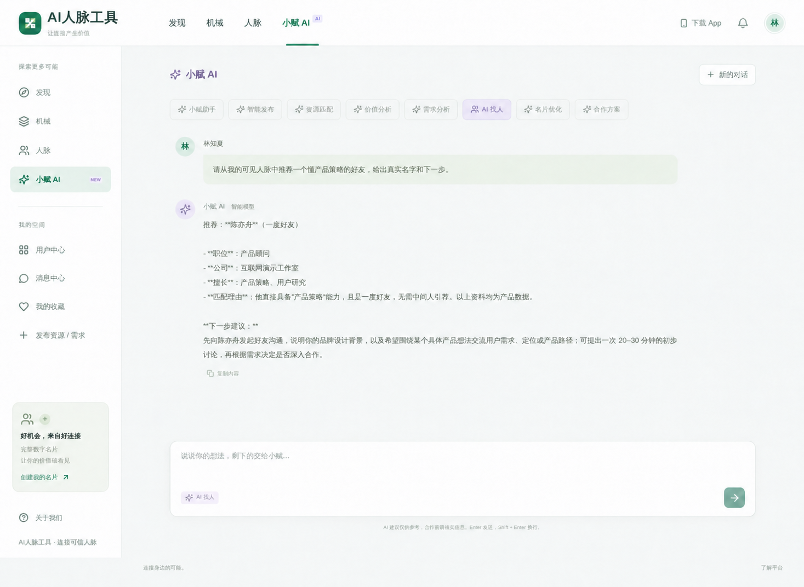
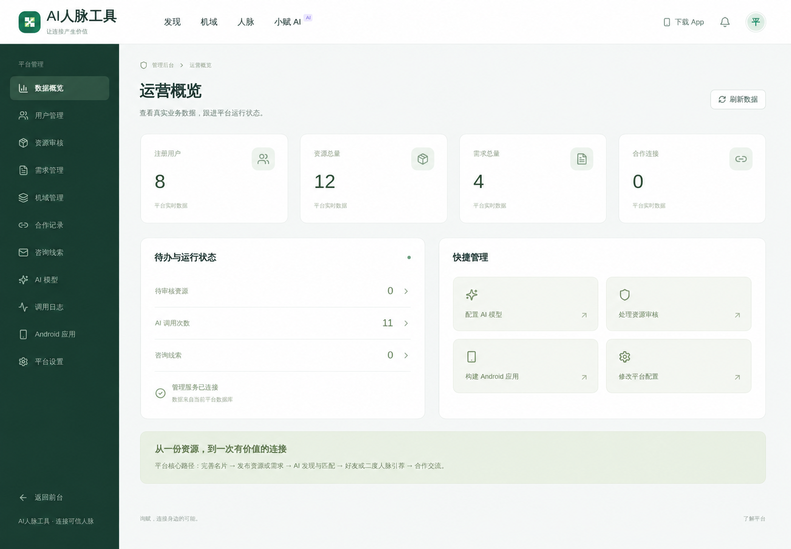

# AI人脉工具 · AI 熟人资源协作平台

AI人脉工具是一套面向商务协作和人脉连接场景的数字名片平台，通过资源发布、需求大厅、好友关系、二度人脉引荐、合作跟进和 AI 助手，帮助用户发现并连接可信的合作资源。

## 主要功能

- 数字名片、职位资料、技能标签和隐私范围管理。
- 资源发布、分类检索、收藏、审核和合作状态跟进。
- 需求发布、供需匹配、好友关系和二度人脉引荐。
- 私信、通知、动态互动和合作记录。
- AI 内容润色、资源推荐、价值分析、智能找人和合作草稿。
- 用户中心、运营后台、审计日志和 Android 客户端。

## 产品界面






## 技术架构

- Next.js 16、React 19、Node.js 22。
- MySQL、JWT HttpOnly Cookie、AES 加密配置。
- Android WebView、Nginx、systemd。

## 环境要求

- Node.js 22+、npm 10+、MySQL 8.0 或兼容版本。
- AI 功能需要兼容的模型服务；Android 构建需要对应 SDK 和签名材料。

## 本地安装

```bash
git clone https://github.com/CharlesYin1204/ai-network-tools.git
cd ai-network-tools
npm ci
cp .env.example .env.local
npm run db:init
npm run dev
```

访问 `http://localhost:3050`。已有数据库应先备份并执行 `npm run db:migrate`，不要重复初始化。

## 环境变量

| 配置 | 说明 |
| --- | --- |
| `DB_HOST`、`DB_PORT`、`DB_USER`、`DB_PASSWORD`、`DB_NAME` | MySQL 连接 |
| `SESSION_SECRET` | 会话签名密钥 |
| `DATA_ENCRYPTION_KEY` | AI 密钥等敏感数据加密密钥 |
| `AI_BASE_URL`、`AI_API_KEY`、`AI_MODEL` | 默认 AI 服务配置 |
| `AI_SECONDARY_MODEL` | 可选备用模型 |

## 构建与测试

```bash
npm run build
npm run test:api
npm run test:browser
npm run test:contract
npm run test:workflows
```

测试应连接隔离数据库；AI 测试可能产生外部调用费用。

## 生产部署

1. 安装 Node.js 22、MySQL、Nginx，创建独立数据库和非登录系统用户。
2. 拉取代码并执行 `npm ci`。
3. 创建权限为 `600` 的 `.env.local`，填写强随机会话/加密密钥。
4. 新库执行 `npm run db:init`；已有库备份后执行 `npm run db:migrate`。
5. 执行 `npm run build` 和必要回归测试。
6. 参考 `deployment/xunfu.service` 运行 `npm start`，内部监听 `3050`。
7. Nginx 反向代理到 `127.0.0.1:3050` 并启用 HTTPS。
8. 配置 `npm run db:backup` 定时任务，并单独备份 Android 签名与私有配置。

更新前执行数据库备份，再安装依赖、执行迁移、构建并滚动重启；迁移或构建失败时保持旧服务运行。

## 项目结构

- `app/`：页面与 API 路由。
- `components/`：产品界面组件。
- `lib/`：业务、鉴权、数据库和 AI。
- `database/`：数据库结构与迁移。
- `scripts/`：初始化、迁移、测试和备份。
- `android/`：Android 客户端。
- `deployment/`：生产服务配置。

## 常见问题

- 页面提示数据库错误：检查数据库账号、库名和迁移状态。
- AI 无法调用：检查服务地址、密钥、模型标识和允许域名。
- 登录状态异常：检查 HTTPS、Cookie 和反向代理协议头。
- APK 构建失败：检查 Android SDK、JDK、签名文件和目录权限。

## 联系方式

微信：`charlesyin6015`

## 开源与二次开发

本项目采用 [MIT License](LICENSE) 开源。你可以点击 GitHub 页面右上角的 **Fork** 创建自己的副本，也可以克隆后创建新分支进行修改：

```bash
git checkout -b feature/my-change
```

请勿提交 `.env`、数据库备份、用户数据或任何真实密钥；部署前请根据 `.env.example` 创建自己的环境配置。
